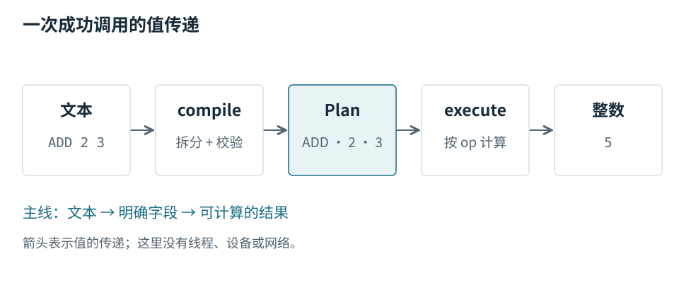

# 第 1 章 · 先找到贯穿项目的对象 {#overview}

Mini Pipeline 把 `ADD 2 3` 这样的文本变成一个执行计划，再返回整数结果。读这个小项目，最有用的主线不是逐个解释函数，而是跟着同一个表达式看它怎样改变形态。[S01](../sources.md#s01)

这是随包教学源码，用来验证素材交接与图文出版，不是真实推理引擎。它没有线程、设备、缓存或性能模型，后文的运行结果只属于这段 Python 代码。

## 系统的边界在哪里 {#boundary}

从左到右看。调用者提供文本；`compile_expression()` 检查并转换它；`Plan` 保存操作名和两个整数；`execute()` 根据计划计算；调用者得到一个整数。图中箭头表示值的传递，不表示网络通信或数据复制次数。[S01](../sources.md#s01)

最值得留意的是中间的 `Plan`。输入文本在进入执行器之前，已经变成了有名字的字段。因此执行器不必重新拆字符串，也不用决定文本究竟有几个词。编译和执行通过一个明确的数据结构连接起来。[S02](../sources.md#s02)

## 为什么分开编译与执行 {#contract}

`Plan` 只有 `op`、`lhs`、`rhs` 三个字段。分开两个阶段，便可以分别检查文本转换和计划执行。对这个小项目，直接解析并计算也能完成任务；明确的接口并不自动证明性能更好。[S02](../sources.md#s02)

## 验证理解 {#check}

把输入换成 `MUL 2 3`，图中哪几段形态保持不变，哪些字段和值发生变化？先根据图作答，再运行源码核对。下一章沿 `ADD 2 3` 走一遍具体值，而不是再画一张同样的模块关系图。
