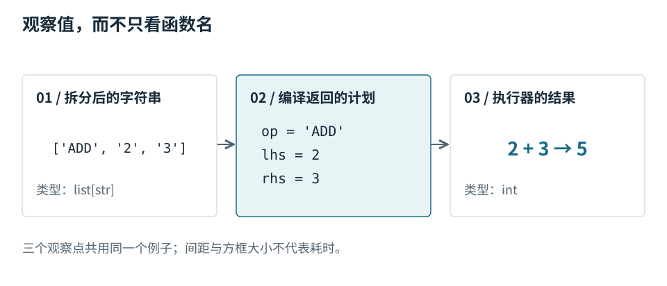

# 第 2 章 · 用具体值走完一次执行 {#trace}

输入仍为 `ADD 2 3`。这次把上一章的箭头替换成具体值：三个字符串、一个 `Plan`，以及整数 `5`。[S01](../sources.md#s01)

## 编译阶段改变了什么 {#example}



先看左列：`split()` 产生三个字符串。编译函数检查数量和操作名，再用 `int()` 转换两个参数，形成中间列的 `Plan`。[S03](../sources.md#s03)

计划中的 `2` 和 `3` 已是整数。右列显示执行器按 `ADD` 分支相加，得到 `5`。三列是观察点，不是三个线程或三段等长耗时。

## 用最小命令核对 {#run}

在本书原始目录执行（教学源码随包保存在 evidence/）：

```bash
python evidence/pipeline.py ADD 2 3
python evidence/pipeline.py MUL 2 3
```

对应输出是 `5` 和 `6`。测试调用同一份源码核对结果；它证明这些输入下的行为，不提供硬件性能指标。中间计划可通过单独调用 `compile_expression()` 查看。[S04](../sources.md#s04)

**验证理解。** 输入 `add 02 3` 会不会得到同样的计划字段？输入 `ADD two 3` 又会在哪一步停止？前一个问题检查规范化，后一个问题引出[下一章的失败路径](03-boundaries.md#failure)。
