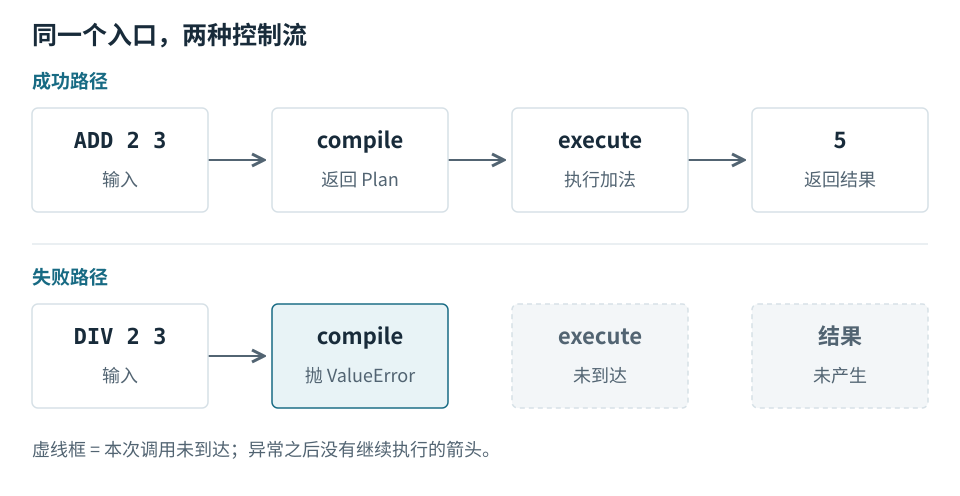
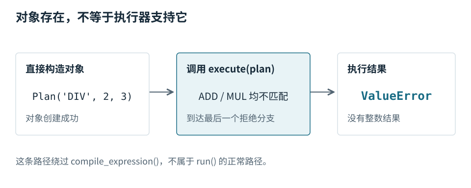

# 第 3 章 · 正常路径之外，接口还承诺什么 {#boundaries}

只看成功例子，很容易误以为每次调用都能生成计划。实际代码先检查输入结构与操作名；校验失败时抛出异常，不会继续调用执行器。[S03](../sources.md#s03)

## 比较成功与失败路径 {#failure}

上面一行是正常输入：编译成功后才进入执行器。下面一行把操作换成 `DIV`；编译函数拒绝它，右侧标为“未到达”的执行器和结果不是隐藏步骤，而是这次调用根本没有执行到的位置。虚线框表示未发生，不表示异步。[S03](../sources.md#s03)

`run()` 只有一条返回语句，但求值顺序仍然重要：内层 `compile_expression(text)` 必须先完成，外层 `execute(...)` 才能取得参数。编译抛出的异常会使这条成功路径中断。[S01](../sources.md#s01)

## 计划对象不是自动合法的 {#direct-plan}

调用者可以直接创建 `Plan("DIV", 2, 3)`。数据类本身没有操作枚举校验，所以对象能被创建；随后 `execute()` 在两个已支持分支之外抛出 `ValueError`。这张图强调的是另一条公开调用路径，不是声称 `run()` 会生成这样的计划。[S02](../sources.md#s02)

因此“编译器已经检查过”不能推出“执行器的检查一定多余”。判断是否能删除后者，要先决定直接调用 `execute()` 是否属于需要支持的接口。本示例保留这条检查，并在测试中覆盖它。

## 一次有边界的修改练习 {#exercise}

尝试增加减法时，先找出两个需要对齐的位置：编译函数允许的操作集合，以及执行函数的运算分支。再增加正常输入、非法输入和直接构造计划的测试。只修改其中一处，会造成接收与执行支持范围不一致。

这个练习的目标是让读者根据书中的接口图回到源码，而不是让书替代源码。大项目也应采用同样的验证方式：找到贯穿路径，检查关键状态，再追一条可能推翻当前解释的分支。

## 验证理解 {#check}

假设只允许调用 `run()`，不再暴露 `execute()`，你会怎样论证执行器的最后一条检查可以保留或删除？答案必须说明接口前提；不能只说“多检查一次更安全”。
