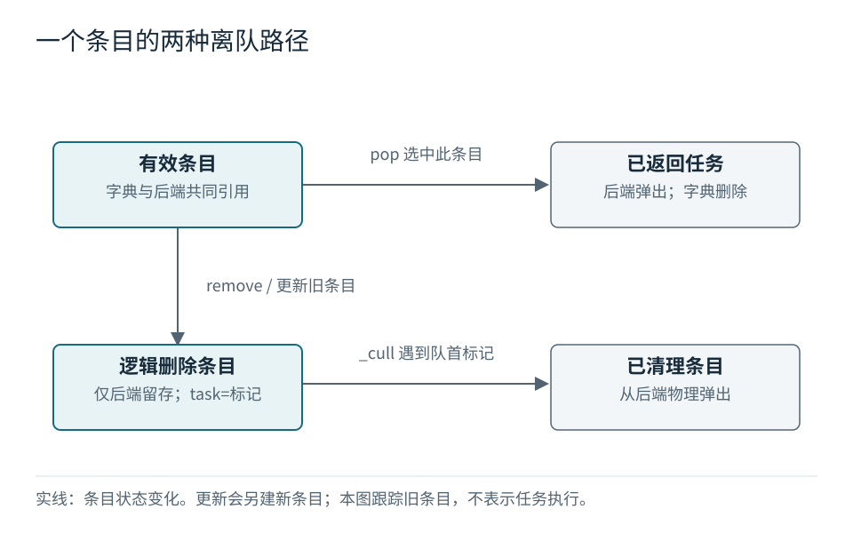

# 第二章　任务离队了，记录为什么还在？ {#removal}

第一章结束时，B 已被取出，C 与 A 仍有效。现在更新 A，再删除 C。公开接口眼中的队列只剩一个任务，后端却可能保存三条条目。这不是三件待办，而是一件有效任务和两条等待清理的记录。

本章的主要问题是：**逻辑删除与物理移除为什么分开？** 我们会沿着同一条旧记录看它如何失效，再解释更新为何改变同级次序。正常路径与默认优先级转换失败的行为可由包内源码及运行记录互相核对，但不能据此承诺任意异常下的回滚。

## 改掉任务槽，就能让两边同时看见 {#tombstone}

回想一个 `entry` 同时由字典和后端引用。材料给出的 `remove` 核心动作是：

```python
entry = self._entry_map.pop(task)
entry[-1] = _REMOVED
```

先从字典删除任务映射，再把同一条目的任务槽改成私有标记 `_REMOVED`。后端所引用的列表也随之变了，因为那就是同一个对象。有效优先级和序号没有改变，条目可以继续待在原来的排序位置，等待将来的清理。[S01](../sources.md#s01)

这种失效标记通常称作**墓碑**。它表达的是“这条记录不再代表有效任务”，而不是“任务已经执行完毕”。更不能把墓碑想象成永久保存原任务的盒子：任务槽已经替换为标记，这条记录对旧任务的该处引用也随之释放。其他地方是否仍引用任务，是另一个问题。

下面的图只追踪一条记录。请先区分向右的正常弹出和向下的逻辑删除，再看删除后的记录何时真正离开后端。



向右走时，`pop` 取出有效任务并删除映射；向下走时，映射先消失，物理条目仍在。底部向右的箭头有一个条件：墓碑到达队首，并且访问队首的过程调用清理逻辑。它不是一个后台线程，也不表示删除后自动扫描整个容器。

材料对 `_cull` 的描述是不断查看 `_pq[0]`：若任务槽是 `_REMOVED`，就弹出这条记录并继续；遇到有效记录便停止。这个停止条件很重要。清理只负责让当前队首可用，不负责消灭深处的全部墓碑。

## 更新让任务重新排一次队 {#update}

把 A 的输入优先级从 1 更新到 3，不能理解为只把旧条目的第一槽从 −1 改为 −3。材料报告的成功路径是旧条目失效、创建新条目，并取得新的序号。原来的 A 使用序号 0，新 A 使用序号 3，于是它与 C 同级，却排在 C 后面。

这里稳定的不是“这个任务最初出现的历史位置”，而是参与当前排序的条目序号。正常更新会重新获得位置；理解这一点，才能判断一个不断更新的任务会怎样与同级任务相处。当前材料不支持进一步推导长期公平性。[S01](../sources.md#s01)

将两章的例子接起来，下面每一行都继承上一行状态。`×` 只是本书表示 `_REMOVED` 的记号，不是代码中的字符串。物理条目仍采用排序队列的有序展开；这是材料报告的走读，并非本次执行记录。[S02](../sources.md#s02)

| 操作后 | 有效数 L | 物理数 N | 后端条目 | 发生的变化 |
|---|---:|---:|---|---|
| 第一章 `pop` 返回 B | 2 | 2 | `[-3,2,C]`，`[-1,0,A]` | 继续处理 C、A |
| 更新 A 到 3 | 2 | 3 | `[-3,2,C]`，`[-3,3,A]`，`[-1,0,×]` | 一个新条目替代一个旧条目 |
| `remove('C')` | 1 | 3 | `[-3,2,×]`，`[-3,3,A]`，`[-1,0,×]` | C 失效，物理数不减 |
| `peek()` 返回 A | 1 | 2 | `[-3,3,A]`，`[-1,0,×]` | 先清掉队首的 C 墓碑 |
| `pop()` 返回 A | 0 | 1 | `[-1,0,×]` | 已无有效任务，旧 A 记录尚存 |
| `pop(None)` 返回 `None` | 0 | 0 | 空 | 清掉最后墓碑，再使用默认值 |

倒数第二行解释了章首的疑问：`len` 数的是 `_entry_map` 中的有效任务，不是 `_pq` 的物理条目。材料给出的实现是 `return len(self._entry_map)`。所以 L 为零并不推出 N 为零。反过来，第三行的 N 为 3 也不代表还有三件任务能被取出。

## 转换失败，为什么旧任务仍在？ {#failure-gap}

已有任务更新时，如果新优先级不能转成浮点数，旧任务是否仍可取出？答案藏在 `add` 的语句次序中。固定版本源码 L132–138 先调用 `_get_priority(priority)`，转换成功后才判断成员并调用 `remove`，随后取得新序号、建立条目、登记映射并插入后端。[S01](../sources.md#s01)

研究探针先加入 `stable`，优先级为 2，再执行 `add('stable', 'bad')`。默认转换抛出 `ValueError` 后，两种后端的原始记录都显示 `peek()` 返回 `stable`，有效数和物理数均为 1，条目仍是 `[-2.0, 4, 'stable']`。序号 4 来自此前的走读，而不是异常更新获得的新序号。这与“转换失败，尚未删除旧项”的源码次序一致。[S02](../sources.md#s02)

因此，这个默认转换失败案例保留了旧任务；这里不把“仍可查看”冒充探针实际调用过失败后的 `pop`，可取出行为由保留条目和 `pop` 源码共同支持。对于会自行修改外部状态的自定义 key、后端比较或插入异常，不能推广成同样的保证。映射在后端插入之前写入，源码并没有通用回滚步骤。

其他边界也需要分清“材料报告的观察”和保证范围：

| 输入或操作 | 当前材料支持的说明 | 限定 |
|---|---|---|
| 删除不存在的任务 | 材料报告 `KeyError` | 包内输出确认该输入 |
| 空队列 `peek()` / `pop()` | 材料报告 `IndexError` | 未传默认值时；错误消息分别为 `peek on empty queue`、`pop on empty queue` |
| 空队列显式给 `None` 默认值 | 返回 `None` | `pop(None)` 有实测；`peek(None)` 由源码确认，与未传默认值不同 |
| 列表作为任务 | 材料报告因不可哈希而 `TypeError` | 来自字典成员操作的约束 |
| 自定义 key 返回不可比较值 | 不能承诺失败会回滚 | 材料依据“先写映射，后插后端”作静态推断，未做异常注入 |
| 输入大整数 | 默认浮点转换可能丢失整数精度 | 材料报告 `9007199254740993` 转成 `9007199254740992.0` 后再取负 |
| NaN、无穷大 | 材料称转换可接受且代码无有限性检查 | 不据此承诺 NaN 有意义的优先次序；包内无 NaN 运行案例 |

大整数例子说明另一种同级：两个不同输入可能转换成同一个浮点比较值。这时排序面对的是转换后的值，而不是用户心中的精确整数差。这个数值示例有包内实验记录；Python 文档背景以研究者自写摘要保存，并未附入文档全文。[S02](../sources.md#s02)、[S04](../sources.md#s04)

私有 `_REMOVED` 还被材料描述为“没有提供默认值”的哨兵，不应当作为公开任务或默认值使用。至于恶意比较函数、变化中的哈希值、并发访问及跨版本兼容性，本书没有验证；也不把条目状态图画成线程安全的生产者消费者协议。

## 删除省下的工作，可能留给下一次访问 {#cost}

惰性删除把两份工作分开了：删除调用负责让任务失效，队首访问负责清理挡路的墓碑。由此讨论成本时，必须同时看物理条目数 N 和有效任务数 L。

在通常的哈希与相等操作假设下，材料把 `remove` 描述为平均 O(1) 的字典操作加一次槽改写。对堆后端，插入条目的后端成本按物理 N 计为 O(log N)。这些是材料中的分析，不是本书进行过的性能测量。

一次公开 `peek` 或 `pop` 还可能先清掉 c 个墓碑。如果只写“peek 是 O(1)”或者把所有堆操作规模写成 L，就漏掉了这段实际工作。持续更新又迟迟不访问队首，会产生更多物理记录；逻辑队列很小也不能据此判断物理存储很小。材料没有自动全量压缩的机制，也没有量化某种业务下会积累多少记录。

排序后端则需要另行研究 `BarrelList`，不能直接搬用内建列表的复杂度结论。本书到此停止，不用未经测量的“更快”替代后端选择所需的负载和基准数据。

最后回看 A：它最早进入，却因为低优先级落后；更新后与 C 同级，又因为新序号落后；取走新 A 后，旧 A 的墓碑仍可能存在。沿着这三步，任务、条目和排序位置已经分开。读代码时可以据此追踪正常操作；涉及失败时，则要定位异常发生在哪一步：默认转换失败发生在删除之前，后端插入失败却不能据此承诺回滚。
